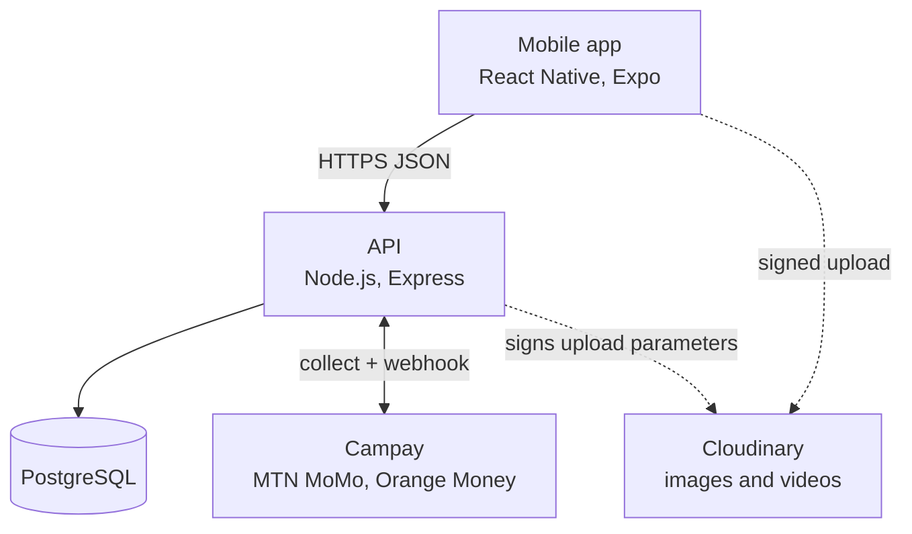

# Architecture

The app only talks to the API, except for media uploads, which go straight to Cloudinary using
parameters the API signed. Secrets (Campay, Cloudinary, JWT) never leave the server.

## Repository

| Path              | Content                                                                         |
| ----------------- | ------------------------------------------------------------------------------- |
| `apps/api`        | Express + TypeScript backend, Drizzle ORM, one folder per module                |
| `apps/mobile`     | Expo Router app, organised by feature                                           |
| `packages/shared` | Types and constants used by both (post types, API response shapes, error shape) |
| `docs`            | This documentation and the specification                                        |

## Backend

A modular monolith. Each module of the specification has its own folder in
`apps/api/src/modules` (see the README there). Cross-cutting code lives in:

- `src/config`: environment variables, validated with Zod at start-up
- `src/db`: Drizzle schema (one file per area) and the database client
- `src/middleware`: authentication, device id, validation, quota guard, error handling
- `src/lib`: errors, JWT, logger, helpers
- `src/jobs`: scheduled jobs (subscription expiry and reminders)

### Conventions

- **Errors**: throw `AppError` (helpers in `src/lib/errors.ts`). The error handler always answers
  `{ "error": { "code", "message", "details?" } }` (type `ApiErrorBody` in `packages/shared`).
- **Validation**: Zod schemas in `<module>.schemas.ts`, applied with the `validate` middleware.
- **Authentication**: `Authorization: Bearer <token>` (JWT). Use `requireAuth`, `optionalAuth`, `requireAdmin`.
- **Devices**: the app sends `X-Device-Id` on every request. It identifies visitors for the free daily time.
- **Passwords**: stored only as bcrypt hashes (`passwordHash`).
- **Configuration**: durations, prices and quota values are configuration, never hard-coded (NFR12).

## Key flows (details in the specification, section 5)

**Free daily time.** The app sends a usage update every 10 to 15 seconds while the feed is open.
The server adds the elapsed time (capped by `USAGE_HEARTBEAT_MAX_GAP_SECONDS`) to the day's total,
using server time. `quotaGuard` rejects feed requests with `402 QUOTA_EXHAUSTED` when the daily
time is used up. Subscribers are never limited.

**Payment.** `POST /payments` creates a pending payment and starts a Campay collection. The user
approves on the phone. Campay calls the webhook; the API re-checks the transaction status with
Campay, processes each `providerReference` once, then activates the subscription in one database
transaction. A new subscription starts when the current one ends (BR4).

**Media.** The app asks `POST /media/signature`, uploads to Cloudinary, then calls `POST /posts`
with the returned public id and URL. Only these are stored in PostgreSQL.

## Database

Drizzle schema files in `apps/api/src/db/schema`, SQL migrations in `apps/api/drizzle`.
Enum values come from `packages/shared` so the API and the app stay in sync.
