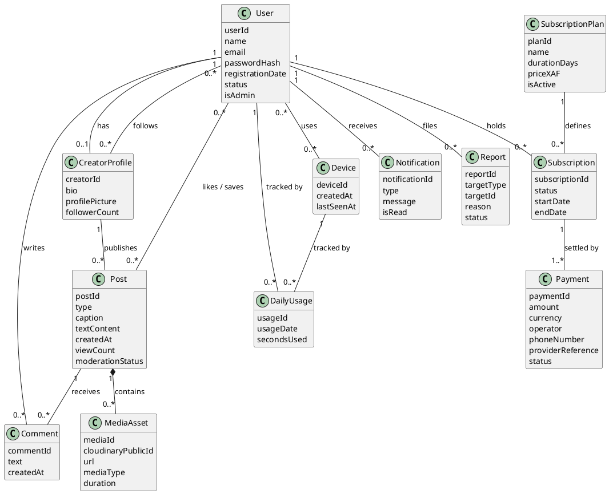

# Specification Document

**Theme: Content Creator Platform with Free Daily Access and Subscription**

Option: Application Design for the Digital Economy

Institut Universitaire Saint Jean

**Written and presented by**

- BARKA HAMIDOU SALOMON
- BIEM HERMES PRIDE
- NGEGUIM SOB FRED
- NGASKA CEDRIC

**Academic Supervisor:** Mme Ytembe Therese

**Academic Year:** 2026 - 2027

**Version:** 2 - revised draft, November 2026

---

## Contents

1. [Introduction](#1-introduction)
2. [Presentation of the Project](#2-presentation-of-the-project)
   - [2.1 General Presentation](#21-general-presentation)
   - [2.2 Project Context](#22-project-context)
3. [Use Cases and Requirements](#3-use-cases-and-requirements)
   - [3.1 Actors and Their Roles](#31-actors-and-their-roles)
   - [3.2 Functional Requirements](#32-functional-requirements)
   - [3.3 Non-Functional Requirements](#33-non-functional-requirements)
   - [3.4 Use Case Modules](#34-use-case-modules)
4. [Domain Model](#4-domain-model)
   - [4.1 Entities and Attributes](#41-entities-and-attributes)
   - [4.2 Main Relationships](#42-main-relationships)
   - [4.3 Business Rules](#43-business-rules)
   - [4.4 Diagrams](#44-diagrams)
5. [Key Interaction Flows](#5-key-interaction-flows)
   - [5.1 Authentication and User Profiles](#51-authentication-and-user-profiles)
   - [5.2 Creator and Post Management](#52-creator-and-post-management)
   - [5.3 Feed and Free Daily Access](#53-feed-and-free-daily-access)
   - [5.4 Subscription Management](#54-subscription-management)
   - [5.5 Payment Management (Campay)](#55-payment-management-campay)
   - [5.6 Social Interaction and Notifications](#56-social-interaction-and-notifications)
   - [5.7 Administration and Moderation](#57-administration-and-moderation)
   - [5.8 Summary of API Endpoints](#58-summary-of-api-endpoints)
6. [Open Decisions and Risks](#6-open-decisions-and-risks)
7. [Conclusion](#7-conclusion)
8. [Appendix A. PlantUML Source of the Analysis Class Diagram](#appendix-a-plantuml-source-of-the-analysis-class-diagram)

---

## 1. Introduction

Smartphones and affordable mobile internet have changed the way people create, share and consume content. Every day, individuals publish videos, photographs and short texts to reach an audience, and followers spend a large part of their time scrolling through feeds of such content. Social platforms of this kind rely mostly on advertising. Few of them are designed around the payment methods that are common in Cameroon, such as mobile money.

This project aims to design and develop a **Content Creator Platform**: a mobile application in which every user can both consume and publish content - videos, images and text posts - in a social feed. Access to the feed is free for a limited amount of time each day. Once this free daily time is used up, the user is invited to take a paid subscription, which gives unlimited access to the content of the platform. Payments are made through mobile money.

This document presents the general overview and context of the project, then the actors, the functional and non-functional requirements, the domain model, the key interaction flows, and the decisions that are still open. It is the revised version of the first specification: the scope, the access model and the technology choices have been clarified and the document has been made consistent around a single product.

## 2. Presentation of the Project

### 2.1 General Presentation

The Content Creator Platform is a social content application built on the following principles:

- **One account, two abilities.** Any user can watch content and any user can switch on creator mode to publish content. A creator remains a viewer and a viewer can become a creator at any time.
- **A feed of all post types.** Creators publish video, image and text posts. All of them appear in the same feed and are consumed in the same way.
- **Free daily viewing time.** Users without an active subscription can use the feed for a limited time each day. The remaining time is kept by the server, so it does not reset when the user closes and reopens the application.
- **Platform-wide subscription.** A paid subscription gives unlimited access to the platform's content for the duration of the subscribed period.
- **Mobile money payments.** Subscription payments are processed through the Campay payment APIs (MTN Mobile Money and Orange Money).

#### 2.1.1 Access levels

| Level | Description | What the user can do |
| --- | --- | --- |
| **Visitor** | Person using the application without an account. | Browse the feed during the daily free time. Is prompted to create an account or subscribe when the time is used up. |
| **Member** | Registered user without an active subscription. | Same daily free time as the visitor. Can follow creators, like, comment, save posts, manage a profile, switch on creator mode and publish. |
| **Premium Member** | Registered user with an active subscription. | Unlimited access to the feed and all member features for the subscribed period. |
| **Creator** | A member or premium member who has switched on creator mode. This is an ability, not a separate account type. | Publish, edit and delete own posts and view audience statistics. |
| **Administrator** | Person managing the platform. | Moderate content, manage users, monitor transactions and platform activity. |

> Design rules attached to these levels: (1) the free daily time measures *viewing* time only; publishing is not counted; (2) when the free time is used up, browsing other users' posts is blocked and the subscription prompt is shown, while the profile, publishing and subscription screens remain available.

#### 2.1.2 Expectations of the project

- Provide a simple, attractive environment for publishing and consuming content in several formats.
- Give every user free access for a limited daily time, enforced reliably and fairly.
- Convert regular users into subscribers through a clear paywall prompt and an easy mobile money payment.
- Allow any user to become a creator and to follow how their posts perform.
- Protect user data, accounts and payments, and keep accurate records of subscriptions and transactions.
- Build a secure, scalable and maintainable application that can be extended in later versions.

#### 2.1.3 Scope

**Version 1** covers: account management and role switching, creator mode and profiles, publishing of video, image and text posts, a simple feed, creator discovery and following, likes, comments and saved posts, the daily free-time quota with its paywall, platform subscriptions, payments through Campay, notifications, and administration and moderation.

**Later versions** may include: creator-specific subscriptions and exclusive content, a revenue-sharing model and payouts to creators, a personalised recommendation feed, live streaming, private messaging and paid video calls.

### 2.2 Project Context

#### Academic context

This project is carried out as part of software engineering studies. It applies the full software development life cycle: requirements analysis, system modelling, database design, application architecture, implementation, testing and documentation. It also involves authentication and authorization, media handling and the integration of external services such as a payment gateway. The team is expected to identify a real problem, propose a suitable technological solution, translate user expectations into requirements and deliver a functional application that meets defined quality standards.

#### Technological context

Mobile applications, cloud media services and digital payments make it possible to build a content platform with a small team. A platform of this kind requires several components working together: authentication, a media pipeline, a feed, usage tracking, subscription management, payment processing and access control. The project belongs to the fields of mobile and web development, database management, cybersecurity and digital commerce.

| Component | Choice | Role |
| --- | --- | --- |
| **Mobile application** | React Native, Expo, TypeScript | User interface for visitors, members, creators and administrators. |
| **Backend API** | Node.js with Express | Business logic, authorization, quota enforcement, payment handling. |
| **Database** | PostgreSQL | Users, posts, subscriptions, payments, usage records and moderation data. |
| **Media storage and delivery** | Cloudinary | Storage, compression and delivery of videos and images. |
| **Payments** | Campay APIs | Mobile money collection (MTN Mobile Money, Orange Money) in XAF. |

#### Social and economic context

In Cameroon, many people create and share content, but advertising revenue is small and card payments are not widespread. Mobile money is the most accessible payment method. A platform that charges small, prepaid subscriptions through mobile money can be used by the general public and can later give local creators a way to earn from their audience. Availability of the payment services and their exact conditions must be confirmed with the provider during implementation.

## 3. Use Cases and Requirements

### 3.1 Actors and Their Roles

| Actor | Type | Role in the system |
| --- | --- | --- |
| **Visitor** | Primary | Browses the feed during the daily free time without an account. Sees warnings as the time runs out and is invited to register or subscribe. |
| **Member** | Primary | Registered user without an active subscription. Limited by the daily free time. Interacts with content and can switch on creator mode. |
| **Premium Member** | Primary | Registered user with an active subscription. Has unlimited access to the feed. |
| **Creator** | Primary (ability) | Any member with creator mode on. Publishes and manages posts and consults audience statistics. |
| **Administrator** | Primary | Moderates content, manages users and reported accounts, monitors transactions and platform statistics. |
| **Campay** | External system | Processes mobile money payments and notifies the platform of the result. |
| **Cloudinary** | External system | Stores and delivers media files uploaded by creators. |

> Terminology: the first version of this document used "Subscriber" for every registered user. In this version the word is avoided; "Member" means a registered user and "Premium Member" means a user with an active subscription.

### 3.2 Functional Requirements

#### A. User Account Management

| ID | Requirement |
| --- | --- |
| FR1 | **Registration.** The system shall allow a new user to create an account with the required registration information. |
| FR2 | **Authentication.** The system shall allow registered users to log in and log out securely. |
| FR3 | **Profile management.** The system shall allow users to view and update their personal information and profile details. |
| FR4 | **Account recovery.** The system shall allow users who forgot their password to recover access using a secure, time-limited reset token or code. |
| FR5 | **Role and creator mode.** The system shall allow any registered user to switch creator mode on or off. The system shall also distinguish administrators and grant permissions according to the user's abilities. |
| FR6 | **Password protection.** The system shall never store passwords in clear text; passwords shall be stored only as hashes produced by a strong, salted hashing algorithm. |

#### B. Creator and Post Management

| ID | Requirement |
| --- | --- |
| FR7 | **Creator profile.** The system shall allow a user with creator mode on to create and edit a creator profile (display name, bio, picture). |
| FR8 | **Post publication.** The system shall allow creators to publish posts of type video, image or text, with an optional caption. |
| FR9 | **Post editing and deletion.** The system shall allow creators to edit or delete their own posts only. |
| FR10 | **Creator discovery.** The system shall allow users to search for and browse creators and view their profiles and posts. |
| FR11 | **Following.** The system shall allow members to follow and unfollow creators. |
| FR12 | **Creator dashboard.** The system shall provide creators with statistics on their posts and audience (views, likes, comments, followers). Earnings information will be added once the revenue model is defined. |

#### C. Feed and Free Daily Access

| ID | Requirement |
| --- | --- |
| FR13 | **Feed.** The system shall present a feed of posts of all types. In the first version the feed shall combine recent posts from followed creators with recent or popular posts of the platform. |
| FR14 | **Daily free-time quota.** The system shall give every user without an active subscription a limited amount of viewing time per day. The duration shall be a configurable parameter. |
| FR15 | **Usage counter.** The system shall measure the time a user actively spends in the feed. The application shall send usage updates to the server at regular short intervals while the feed is open and in the foreground; the server shall add them to the user's total for the day. |
| FR16 | **Persistent counter.** The remaining time shall be kept by the server and tied to the user's device (for visitors) and to the user's account (for members), so that closing, restarting or reinstalling the application does not give the user extra time. |
| FR17 | **Server-side enforcement.** The server shall reject feed requests once the daily time is used up. The system shall use server time only, and shall not rely on the phone's clock. |
| FR18 | **Warning.** The system shall warn the user when the remaining time falls below a configurable threshold. |
| FR19 | **Paywall prompt.** When the daily time is used up, the system shall stop the feed and display a prompt inviting visitors to create an account or subscribe, and members to subscribe. The prompt shall show the available plans and the time at which free access returns. |
| FR20 | **Daily reset.** The free time shall reset once per day at a fixed time (proposed: midnight, Cameroon time). |
| FR21 | **Unlimited access for subscribers.** The system shall not apply the daily limit to users with an active subscription. |

#### D. Subscription Management

| ID | Requirement |
| --- | --- |
| FR22 | **Plans.** The system shall offer one or more platform subscription plans, each defined by a duration in days and a price in XAF. Plans shall be configurable without modifying the application code. |
| FR23 | **Subscribing.** The system shall allow a user to subscribe by selecting a plan and paying for it. |
| FR24 | **Status tracking.** The system shall record and display the status of the subscription (pending, active, expired, cancelled), its start date and its end date. |
| FR25 | **Renewal.** The system shall allow a user to renew by paying again. If the user pays while a subscription is still active, the new period shall start when the current one ends. |
| FR26 | **Expiry reminders.** The system shall notify the user a few days before the subscription ends, and again when it has ended. |
| FR27 | **Expiry behaviour.** When a subscription ends, the user shall return to the free daily time limit. |
| FR28 | **Cancellation.** The system shall allow users to cancel their subscription, stop reminders and state clearly that access remains until the end date already paid for. |
| FR29 | **History.** The system shall allow users to view their current and previous subscriptions. |

#### E. Payment Management

| ID | Requirement |
| --- | --- |
| FR30 | **Payment initiation.** The system shall initiate a mobile money payment through Campay for the selected plan, using the phone number and operator chosen by the user. |
| FR31 | **Payment confirmation.** The system shall activate or extend a subscription only after receiving a trusted confirmation of success. The confirmation shall be verified with the provider before it is accepted. |
| FR32 | **Pending and failed payments.** The system shall handle pending, failed and abandoned payments and inform the user of the result. |
| FR33 | **Transaction history.** The system shall allow users to view their payment history. |
| FR34 | **Duplicate protection.** The system shall process each transaction reference only once. |

#### F. Social Interaction and Notifications

| ID | Requirement |
| --- | --- |
| FR35 | **Likes.** The system shall allow members to like and unlike posts. |
| FR36 | **Comments.** The system shall allow members to comment on posts. |
| FR37 | **Saved posts.** The system shall allow members to save posts to a favourites list. |
| FR38 | **Sharing.** The system shall allow members to share a link to a post. |
| FR39 | **Notifications.** The system shall notify users of relevant events: new followers, likes and comments on their posts, payment results, and subscription reminders. |
| FR40 | **Reporting.** The system shall allow users to report a post, comment or account that violates platform rules. |

#### G. Administration and Moderation

| ID | Requirement |
| --- | --- |
| FR41 | **Moderation.** The system shall allow administrators to review reports and take action on content that violates the rules. |
| FR42 | **User management.** The system shall allow administrators to manage user accounts, including suspension and banning. |
| FR43 | **Monitoring.** The system shall allow administrators to view platform statistics and review transaction records. |

### 3.3 Non-Functional Requirements

| ID | Requirement |
| --- | --- |
| NFR1 | **Usability.** A simple, intuitive and consistent interface that needs minimal training. |
| NFR2 | **Performance.** Common actions such as opening the feed or a profile shall respond within an acceptable time under normal conditions. |
| NFR3 | **Security.** Secure authentication, hashed passwords, token-based sessions and encrypted communication. |
| NFR4 | **Authorization.** Users shall only perform the operations allowed by their abilities and subscription status. |
| NFR5 | **Data privacy.** Personal data shall be collected and stored responsibly, with access restricted to authorized personnel. |
| NFR6 | **Reliability.** Records of subscriptions, payments and usage time shall be accurate. |
| NFR7 | **Payment integrity.** Duplicate payments and unauthorized activation shall be prevented by validating callbacks with the provider and by checking transaction identifiers. |
| NFR8 | **Quota integrity.** The daily free-time limit shall be enforced on the server and shall resist simple bypasses such as clearing application data or changing the phone's clock. |
| NFR9 | **Availability.** The platform shall be accessible whenever the hosting infrastructure and external services are operational. |
| NFR10 | **Scalability.** The design shall accommodate growth in users, posts and subscriptions. |
| NFR11 | **Maintainability.** Modular structure, documentation and consistent coding practices. |
| NFR12 | **Configurability.** The daily free time, warning threshold, reset time, plan durations and prices shall be changeable without redeploying the application. |
| NFR13 | **Compatibility and responsiveness.** The application shall support the target mobile platforms and adapt to different screen sizes and orientations. |
| NFR14 | **Data integrity.** Consistency between accounts, posts, subscriptions, usage records and transactions. |
| NFR15 | **Backup and recovery.** Appropriate backup and recovery procedures to avoid permanent data loss. |
| NFR16 | **Media delivery.** Media shall be compressed and delivered in sizes adapted to network conditions, with data-saving behaviour for slow connections. |
| NFR17 | **Accessibility.** Readable text, understandable navigation and adequate contrast. |
| NFR18 | **Auditability.** Important administrative and financial operations shall be logged. |
| NFR19 | **Legal and ethical compliance.** Respect for data protection, intellectual property, payment and moderation rules. |

### 3.4 Use Case Modules

The use case diagrams will be redrawn for this version. The table below lists the content of each module and the actors involved.

| Module | Use cases | Actors |
| --- | --- | --- |
| **1. Authentication and User Profiles** | Register, log in, log out, reset password, change password, manage profile and account settings, switch creator mode on or off. | Visitor, Member, Premium Member, Administrator |
| **2. Creator and Post Management** | Manage creator profile, publish video, image or text post, edit post, delete post, browse and search creators, view creator profile. | Creator, Member, Premium Member |
| **3. Feed and Free Daily Access** | View feed, send usage updates, view remaining time, receive warning, see paywall prompt. | Visitor, Member, Premium Member |
| **4. Subscription Management** | View plans, subscribe, view active subscription, renew, cancel, view history, receive expiry reminders. | Member, Premium Member |
| **5. Payment Management** | Make payment, verify payment, receive confirmation, view payment history. | Member, Premium Member, Campay |
| **6. Social Interaction and Notifications** | Follow creator, like, comment, save, share, report, view notifications. | Member, Premium Member, Creator |
| **7. Administration and Moderation** | Manage users, review reports, moderate content, monitor transactions, view platform statistics, manage reported accounts. | Administrator |

## 4. Domain Model

### 4.1 Entities and Attributes

There is a single **User** entity. A user who switches on creator mode gets one **CreatorProfile**. The entity **Video** of the first version has become the more general **Post**. Attribute names are listed; types are omitted to keep an analysis-level view.

| Entity | Attributes | Notes |
| --- | --- | --- |
| **User** | userId, name, email, passwordHash, registrationDate, status, isAdmin | One account for viewing and publishing. Passwords are stored as hashes only. |
| **CreatorProfile** | creatorId, userId, bio, profilePicture, followerCount, createdAt | Exists only if the user has used creator mode. Linked one-to-one to User. |
| **Post** | postId, creatorId, type (video, image, text), caption, textContent, createdAt, viewCount, moderationStatus | A post owns zero or more media assets. |
| **MediaAsset** | mediaId, postId, cloudinaryPublicId, url, mediaType, duration, width, height | Only the identifier and URL are stored in PostgreSQL; the file is kept in Cloudinary. |
| **Device** | deviceId, createdAt, lastSeenAt, userId (optional) | Generated at first launch. Used to track the free time of visitors. |
| **DailyUsage** | usageId, deviceId, userId (optional), usageDate, secondsUsed | One row per subject and per day. Updated by usage updates from the app. |
| **SubscriptionPlan** | planId, name, durationDays, priceXAF, isActive | Configurable. For example one month, or one and two months. |
| **Subscription** | subscriptionId, userId, planId, status, startDate, endDate | One user can have successive subscriptions. |
| **Payment** | paymentId, subscriptionId, amount, currency, operator, phoneNumber, providerReference, status, createdAt, confirmedAt | providerReference is unique, which protects against duplicates. |
| **Follow** | followerId, creatorId, createdAt | A user follows a creator. |
| **Like** | userId, postId, createdAt | One like per user per post. |
| **Comment** | commentId, userId, postId, text, createdAt | |
| **SavedPost** | userId, postId, savedAt | Favourites list. |
| **Notification** | notificationId, userId, type, message, isRead, createdAt | |
| **Report** | reportId, reporterId, targetType, targetId, reason, status, createdAt | Handled by administrators. |

### 4.2 Main Relationships

- A User has zero or one CreatorProfile.
- A CreatorProfile publishes zero or many Posts. A Post has zero or many MediaAssets.
- A User has zero or many Subscriptions. A Subscription is based on one SubscriptionPlan and is settled by one or many Payments.
- A Device or a User has many DailyUsage records, one per day.
- A User follows many CreatorProfiles, and likes, comments on, saves and reports many Posts.
- A User receives many Notifications.

### 4.3 Business Rules

| Rule | Description |
| --- | --- |
| **BR1** | A user has unlimited feed access if and only if they have a subscription with status active whose end date is in the future. |
| **BR2** | Without an active subscription, the viewing time of a user for the current day must not exceed the configured daily free time. |
| **BR3** | Free time is tracked by device for visitors and by account for members. When a user logs in on a device, the larger of the two daily totals applies. |
| **BR4** | A new subscription starts at the later of the payment confirmation time and the end date of the current active subscription. |
| **BR5** | A payment is confirmed only after the provider's status has been verified; each providerReference is processed once. |
| **BR6** | Only the owner of a post can edit or delete it. Administrators can hide or remove posts for moderation. |
| **BR7** | Prices, durations, daily free time and the warning threshold are configuration values, not fixed in the code. |

### 4.4 Diagrams

The class diagram, object diagram, use case diagrams and sequence diagrams will be redrawn from this version. Appendix A contains PlantUML source for the analysis class diagram so that it can be rendered directly. The suggested object diagram shows a visitor whose free time is used up, who registers, subscribes through Campay and then regains unlimited access.

## 5. Key Interaction Flows

Each flow below is the basis of one sequence diagram. The participants are the user, the React Native and Expo application, the Node.js and Express API, PostgreSQL and, where relevant, Campay and Cloudinary.

### 5.1 Authentication and User Profiles

- **Registration.** The user enters details; the API checks that the email is free, hashes the password, creates the user and confirms.
- **Login.** The API finds the user by email, compares the password with the hash and returns a token with the user data.
- **Profile update.** The API validates the token and the input, then updates the profile.
- **Password reset.** The API answers with a generic message and sends a secure, time-limited reset token or code.
- **Creator mode.** The user switches creator mode on; the API creates a CreatorProfile if none exists.
- **Logout.** The API invalidates the token if supported and the application clears the local session.

### 5.2 Creator and Post Management

- **Upload.** The application asks the API for a signed upload authorization, uploads the media directly to Cloudinary, then sends the returned identifier and URL with the post details to the API.
- **Publish.** The API checks that the user is a creator, validates the content, saves the post and its media records.
- **Edit or delete.** The API verifies ownership; if the user owns the post, it updates or deletes it, otherwise it returns an authorization error.
- **Explore creators.** The application requests the list and the profile of creators from the API.

### 5.3 Feed and Free Daily Access

- **First launch.** The application generates a device identifier and registers it with the API.
- **Open feed.** The application requests the feed. The API computes the remaining time of the day: if the user has an active subscription, the feed is returned without limit; if time remains, the feed is returned with the remaining time; otherwise the API answers that the quota is used up.
- **Usage updates.** While the feed is open and in the foreground, the application sends a usage update every 10 to 15 seconds. The API adds the elapsed time (capped to prevent abuse) to the day's total using server time and returns the remaining time.
- **Warning.** When the remaining time falls below the threshold, the application shows a warning.
- **Paywall.** When the remaining time reaches zero, the application stops the feed and shows the prompt with the available plans and the return time of free access.
- **Reopening.** After the application is closed and reopened, the API returns the same remaining time because the counter is on the server.

### 5.4 Subscription Management

- **View plans.** The application requests the active plans from the API.
- **Subscribe.** The user selects a plan; the API creates a subscription with status pending and the user continues to payment.
- **Activation.** After a verified successful payment, the API sets the status to active and calculates the end date (see BR4).
- **Reminders.** A daily scheduled task creates reminders before the end date and marks ended subscriptions as expired.
- **Cancel.** The API records the cancellation; access continues until the end date.

### 5.5 Payment Management (Campay)

- **Initiate.** The user chooses the operator and enters the mobile money number. The API creates a pending payment and requests the collection from Campay.
- **Approve.** The user receives a prompt on the phone and approves the payment with their PIN.
- **Callback.** Campay notifies the API. The API verifies the transaction status with Campay using the provider reference and checks that it has not been processed before.
- **Outcome.** If successful, the payment is recorded and the subscription is activated; if failed, the failure is recorded; if still pending, the payment stays pending and the application shows a processing status.
- **History.** The user can view past payments.

### 5.6 Social Interaction and Notifications

- Follow, like, comment, save and report actions are authenticated requests that create or remove the corresponding record.
- Events such as a new follower, a like, a comment, a payment result or a subscription reminder create a notification; the user can list notifications and mark them as read.

### 5.7 Administration and Moderation

- The administrator opens the dashboard, reviews reports, moderates posts, manages or suspends users and consults transaction records. The API checks the administrator role on every request.

### 5.8 Summary of API Endpoints

| Module | Endpoints |
| --- | --- |
| **Authentication and profiles** | POST /auth/register, /auth/login, /auth/logout, /auth/forgot-password, /auth/reset-password; GET and PUT /users/me; PATCH /users/me/creator-mode |
| **Creators and posts** | POST /media/signature; POST /posts; GET /posts/{id}; PATCH and DELETE /posts/{id}; GET /creators; GET /creators/{id}; PUT /creators/me |
| **Feed and free access** | POST /devices/register; GET /feed; POST /usage/heartbeat; GET /usage/today |
| **Subscriptions** | GET /plans; POST /subscriptions; GET /subscriptions/me; POST /subscriptions/{id}/cancel |
| **Payments** | POST /payments; POST /payments/webhook/campay; GET /payments/me |
| **Social and notifications** | POST /creators/{id}/follow; POST /posts/{id}/like; POST /posts/{id}/comments; POST /posts/{id}/save; POST /posts/{id}/report; GET /notifications; PATCH /notifications/{id}/read |
| **Administration** | GET /admin/dashboard; GET /admin/reports; PATCH /admin/posts/{id}/moderate; GET and PATCH /admin/users; GET /admin/transactions |

## 6. Open Decisions and Risks

The following points have not been decided yet. They are configurable or isolated in the design so that they do not block development.

| # | Open point | Current position |
| --- | --- | --- |
| 1 | Subscription duration and price | One month or two months under study. Modelled as configurable plans (duration in days, price in XAF). One month by default is the simplest start; a two-month plan can be added as a second plan. |
| 2 | Subscription for creators | The timeline of the subscription for subscribers and creators is still to be defined. The model assumes one subscription per user, whatever the abilities of the user. |
| 3 | Creator revenue | Whether creators receive a share of subscription revenue, and how it is calculated and paid out, will be decided later. Until then the creator dashboard shows audience statistics only. |
| 4 | Publishing without subscription | Publishing is not counted in the free time. Whether a subscription is required to publish is not decided. |
| 5 | Daily free time | Duration, warning threshold and exact reset time are configuration values still to be chosen. |
| 6 | Visitor tracking | Visitors are tracked by a device identifier. A reinstallation may produce a new identifier; encouraging registration after the visitor allowance reduces this risk. |
| 7 | Campay | Supported operators, fees, sandbox testing, webhook signature, and recurring collection must be confirmed in Campay's documentation. Renewal is assumed to be manual, because mobile money payments need the user's approval each time. |
| 8 | Cloudinary | Free-plan limits for video size and bandwidth must be checked. Delivery costs may grow with usage; media is stored by identifier so the provider can be changed later. |
| 9 | Feed ranking | Version 1 uses a simple rule (followed creators and recent or popular posts). A recommendation algorithm is for a later version. |

## 7. Conclusion

This revised specification describes a single, coherent product: a social content platform on which any user can watch and publish videos, images and text, with free daily viewing time and a platform subscription paid through mobile money. It identifies the actors, the functional and non-functional requirements, the domain model and the key flows of the system, and it separates what is decided from what remains open.

The next stages are to redraw the use case, class, object and sequence diagrams from this version, to settle the open decisions - especially the subscription period and the daily free time - and to start the database design and the implementation. Particular attention must be given to the reliability of the usage counter, to payment verification and to the protection of user accounts.

---

## Appendix A. PlantUML Source of the Analysis Class Diagram

Attributes are shown without types, as required for an analysis diagram. Paste the code into a PlantUML renderer to produce the diagram.

